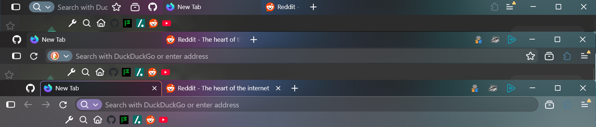

# FoxMica

A Firefox theme for Windows 11: the real Mica backdrop and Explorer-style tabs, in three flavours. Pick the one that suits you, or just use the tabs. Built on [FoxOne](https://github.com/Firnschnee/FoxOne) by Firnschnee.

> **Work in progress.** Tested mainly on Firefox Nightly on Windows 11, with the Nova redesign on (the default) and off. ESR 153 works too: the two bugs found there are fixed, but it hasn't had a full test pass yet. Versions in between have not been tried extensively.

## What is FoxMica?

**Compact.** Extreme prejudice against padding, and meant to blend in. The bar height follows Firefox's UI density (compact, normal, touch).

**Quiet.** Back, Forward and Reload reveal when you hover the bar, after a short delay so a quick pass doesn't shift the URL field, and they give way again when you click into the URL text. The URL-bar icons hide on the edges: permissions under the shield on the left, content actions (Reader, translate and so on) under the star on the right, and the URL field grows from the middle when you hover either. Pinned extensions tuck behind the puzzle button and reveal when you hover it. On one bar this has no off switch, by design (see [Quirks and tips](#quirks-and-tips-foxone-mica)).

**Looks like Explorer.** Mica behind the tab strip and URL bar, the genuine Windows backdrop. Rounded top corners, flat inactive tabs, a filled selected tab and thin separators. Two layers: the top row is the plain Mica "strip", and the selected tab, the bookmarks bar and the sidebar sit on a lighter "layer" above it.

**Easy to set up.** One settings file per mode (`foxmica-config.css`, or `micaplus-config.css` for StockMica+), shared by the browser UI and the about: pages and new tab, so the two can't drift apart. Nothing is forced: no `user.js`, no preference changes, no toolbar layout changes. You set the [prefs](#aboutconfig-prefs) yourself.

## Pick your flavour

You choose in `userChrome.css`; the comments there say how. Each flavour has its own page with the details.

### FoxOne-Mica (the default)

FoxOne's one-line bar (tabs, URL bar and buttons in one row) with Mica behind it, two layers like Explorer, quiet navigation buttons and URL-bar icons, and a floating bookmarks bar. It is on out of the box. [More about FoxOne-Mica](https://github.com/snkiz/FoxMica/blob/main/docs/foxone-mica.md).

### StockMica+

Firefox's own two rows (tabs above, URL bar below) with the same Mica look and palette. To turn it on, comment out the `foxmica-config.css` import in `userChrome.css`, uncomment `micaplus-config.css`, and add that file to `chrome`. It also works in PWAsForFirefox windows. [More about StockMica+](https://github.com/snkiz/FoxMica/blob/main/docs/stockmica-plus.md).

### OEM drop-in replacement tabs

Just the Explorer-style tabs, on regular Firefox or under another theme, and nothing else. The colours follow whatever theme is in use. To turn it on, comment out every `@import` above `foxmica-tabs.css` in `userChrome.css`; only `userChrome.css` and `foxmica-tabs.css` are needed. [More about the tabs](https://github.com/snkiz/FoxMica/blob/main/docs/oem-tabs.md).

## New in 0.9.2

- **ESR 153 works better.** The URL bar widens while you type again and the selected tab's text has the right colour.
- **The extension drawer works in PWAsForFirefox windows**, and a new setting (`--ut-drawer-side`) picks which side of the puzzle button it opens on.
- **StockMica+ has more room around the URL field**, and the vertical tab list is no longer forced to one bar height.
- **Built on FoxOne 3.9.10**, so the bookmarks bar reveals only when the pointer rests on the URL text.

The full list is in [CHANGELOG.md](CHANGELOG.md) old versions on the tag. It's a live file.

## Requirements

- Windows 11. Mica does not exist on other systems.
- Firefox (Nightly), see the note above.
- Transparency effects on: Windows Settings -> Personalization -> Colors.

## Install

1. Close Firefox completely.
2. Open your profile folder (`about:support`, the Profile Folder row).
3. Create a folder named `chrome` there if it doesn't exist.
4. Copy these **six files** into `chrome`. They load each other by name, so all six must be there:
   - `userChrome.css`
   - `foxone-mica.css`
   - `foxmica-config.css`
   - `micaplus-config.css`
   - `foxmica-tabs.css`
   - `userContent.css`
5. Set the prefs below in `about:config`.
6. Start Firefox.

The other two modes are described above; their pages say which files they need.

## about:config prefs

| Pref | Value | Why |
| --- | --- | --- |
| `toolkit.legacyUserProfileCustomizations.stylesheets` | `true` | Needed. Without it Firefox ignores everything in `chrome`. |
| `widget.windows.mica` | `true` | Needed. Turns on the Mica backdrop. |
| `browser.tabs.allow_transparent_browser` | `true` | Optional. Lets blank tabs show Mica too. Flaky on laptops with a discrete GPU. |
| `browser.display.background_color` (and `.dark`) | `transparent` | Optional. Goes with the pref above. |
| `browser.compactmode.show` | `true` | Older Firefox only. Shows the Compact option under Customize -> Density. Nightly has dropped it; density is under about:settings now. |

The floating bookmarks bar needs the bookmarks toolbar set to "Always Show". The other options hand the bar back to Firefox, so there is nothing for the theme to reveal.

## Quirks and tips (FoxOne-Mica)

- The right end of the bar is cramped: room for one tool, maybe two. Hovering the hamburger pushes them over, and Customize mode is tighter still. It is a shockingly cramped corner, held together with hopes and dreams.
- The hamburger's hover-reveal has no off switch, by design.
- Pinned extensions sit at the end of the toolbar and behave normally. Drag one into the stack beside the hamburger and it hides until you hover the hamburger.
- Customize mode does odd things to the bar, in stock Firefox too: the new-tab button pins to the end of the tab bar and a large gap shows on the left. It is only how the bar draws in that mode ([#40](https://github.com/snkiz/FoxMica/issues/40)).
- Short on toolbar? Nothing stops you putting things in the bookmarks bar. ;)
- Spacing is finicky. `--uc-hamburger-width` (30px) sets how far out the extensions flyout sits, and 30px fits the puzzle button. `--uc-extensions-button-width` (32px) is the puzzle button's spacing; 30px will not fit if you change it. `--uc-toolbar-button-width` and `--uc-newtab-width` (26px) are the generic icon spacing.

## More

- [Settings](https://github.com/snkiz/FoxMica/tree/main/docs): how `userChrome.css` picks a flavour, the optional blocks, and a page for each flavour.
- [Building from source](https://github.com/snkiz/FoxMica/blob/main/scripts/README.md): for changing FoxMica itself.

## Known issues

Hovering Mica areas sometimes flickered during development on a laptop with NVIDIA and integrated graphics. It's intermitent with reboots and driver updates. If you are using an optimus laptop, turning off hardware acceration in firefox (and eletron apps for that matter) helps.

The floating bookmarks bar only reveals when the pointer rests on the URL text, not the whole top row or the icons beside it. That is how FoxOne works

- Vertical tabs are untested in any mode. If it works, thank [@Firnschnee](https://github.com/firnschnee) ([#31](https://github.com/snkiz/FoxMica/issues/31)).

And more on the [issue tracker](https://github.com/snkiz/FoxMica/issues)...

## Contributing

Bug reports and ideas are welcome: please open an issue.
Want to send a pull request? Open an issue first and state your case. I'll ask for the PR if it fits.
This is a hobby project and I review everything by hand, so unrequested PRs may sit or be closed.

Testers wanted: FoxMica has only been tried on one screen. Screenshots from other screen sizes and Windows scale settings are very welcome, see [#23](https://github.com/snkiz/FoxMica/issues/23).

FoxMica dev does not have a Mac. If you would like to see FoxMica on Mac, it does have it's own transpency. It's worth a look, see [#40](https://github.com/snkiz/FoxMica/issues/40)

## Credits

- [FoxOne](https://github.com/Firnschnee/FoxOne) by Firnschnee (MIT). `foxone-mica.css` and `userContent.css` are built from FoxOne 3.9.10, kept exactly as released in `vendor/`, plus FoxMica's changes in `patches/`. FoxOne in turn credits [LittleFox](https://github.com/biglavis/LittleFox) and [Cascade](https://github.com/andreasgrafen/cascade).
- The extension drawer in `patches/userChrome/48-unpinned-puzzle-drawer.css` reuses FoxOne's "unbroken run" pattern for tucking away extension icons.
- The Mica rules in `patches/userChrome/22-mica.css` are derived from [Wintego's Firefox-transparent-theme](https://github.com/Wintego/Firefox-transparent-theme).
- The look was matched by eye against Windows 11 Explorer and the MicaBar theme of Windhawk's [Windows 11 File Explorer Styler](https://windhawk.net/mods/windows-11-file-explorer-styler) mod (Windhawk is by [m417z](https://github.com/m417z)). No code from that project was used.
- [@C-O-D](https://github.com/C-O-D) for the catch that put the finishing polish on the URL-bar icons ([FoxOne#59](https://github.com/Firnschnee/FoxOne/issues/59)). First outsider.
- Tab style: written by snkiz, with help from Claude (Anthropic).

## License

MIT, the same as FoxOne. See [LICENSE](LICENSE), which keeps FoxOne's copyright notice.
