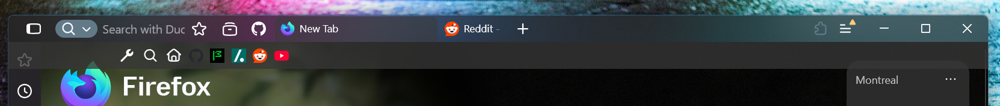

[Back to the README](../README.md) · [Settings](README.md)

# FoxOne-Mica: the full theme
- **One-line layout** from FoxOne: tabs, URL bar and buttons share one row.

FoxOne's one-line bar with FoxMica's changes built in (`foxone-mica.css`). It is on by default in `userChrome.css`, and its settings are in `foxmica-config.css` (see [Settings](#settings) below).

## Settings

Everything you are meant to change is in `foxmica-config.css`. It is variables only. The file's own comments explain each one; this is the short version.

| Setting | What it does |
| --- | --- |
| `--uc-color-base`, `-surface`, `-accent`, `-text`, `-hover` | The palette (dark). The `--uc-light-*` set is used when Firefox runs light. |
| `--uc-rounded`, `--uc-border-radius` | Rounded corners on or off, and how round. |
| `--ut-bar-height-compact / -normal / -touch` | Height of the one-line bar for each Firefox UI density. |
| `--ut-bar-padding` | Space above and below the tabs and URL field inside the bar. |
| `--ut-btn-inner-*`, `--ut-btn-outer` | Toolbar button padding, which sets how far apart the icons sit. |
| `--ut-tab-radius`, `--ut-tab-top-gap`, `--ut-tab-weight` | Tab corner radius, gap above tabs, font weight. |
| `--ut-tab-pinstripe` | The thin edge around the selected tab: `1` shows it, `0` hides it. Off in FoxOne-Mica and StockMica+, on in OEM drop-in replacement tabs. |
| `--ut-tab-pinstripe-color` | Colour of that edge on Firefox's own themes (commented example in `foxmica-config.css`). Default is the accent colour. |
| `--ut-layer` | The colour and see-through-ness of the layer (selected tab, bookmarks bar, sidebar). Lighter grey or lower alpha = lighter tab. |
| `--ut-puzzle-color` | Colour of the extensions (puzzle) button icon, in every mode. A bit of flare; set `currentColor` for Firefox's plain look. |
| `--ut-bookmarks-inflow` | The bookmarks bar floats over the page (`0`) or sits in the page flow (`1`). |
| `--ut-bookmarks-bg` | Colour of the floating bookmarks bar (commented example in `foxmica-config.css`). The last number is its opacity: lower lets the page show through more. |
| `--ut-drag-left` | Window-drag area left of the sidebar button when not maximized. `0` removes it. |
| `--ut-hide-trust-label` | Hide the text next to the site-info icon ("Not secure"). Default: hidden. |
| `--ut-hide-pip-button` | Hide the picture-in-picture button in the URL bar (the video has its own). Default: hidden. |
| `--ut-hide-disabled-nav` | Hide the Forward button alone while it has nowhere to go (`0` off, `1` on). FoxOne's own `--uc-hide-disabled-nav-buttons` hides Back as well. |
| `--uc-autohide-nav-buttons` | FoxOne's nav reveal: `0` always show, `1` hover and focus, `2` hover only. Mode `2` also gives click-to-cancel. |
| `--ut-hover-delay` | How long you hover before the nav buttons and the bookmarks bar reveal. |
| `--ut-hide-delay` | How long they wait before hiding again. |
| `--ut-findbar-left` | Put the floating find bar on the left (`1`) instead of the right (`0`). |
| `--uc-status-panel-spacing` | Gap from the window edge for the status text and the floating find bar (`0` = corner). |

A few more values are not in the config because they follow from the ones above: `--ut-strip` (a tint for the top row, plain Mica by default), `--ut-tab-hover-bg`, `--ut-separator` and `--ut-bookmarks-height`. They sit in the "LAYER VALUES" block in `patches/userChrome/20-layer-values.css`. Change one there, then run `node scripts/assemble.mjs` (see [Building from source](../scripts/README.md)), because `foxone-mica.css` is a built file.

Further down the file are FoxOne's own settings with the values chosen here (URL bar width, tab widths, and so on). FoxOne's [customisation guide](https://firnschnee.github.io/FoxOne/customisation.html) documents those.

StockMica+ has its own short list of differences in [its page](stockmica-plus.md); OEM tabs has five in [its page](oem-tabs.md).
