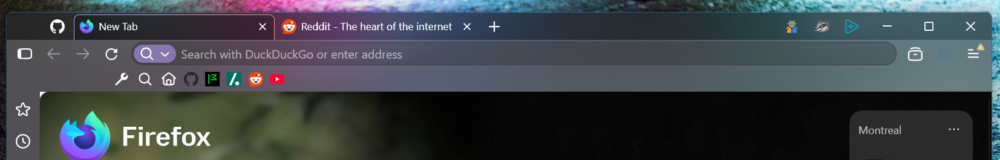

[Back to the README](../README.md) · [Settings](README.md)

# OEM drop-in replacement tabs
- **Nova, without the floating pill tabs**

Just the Explorer-style tabs and nothing else. Use it on regular Firefox or under another theme. It doesn't touch the palette, so the tabs take the colours of whatever theme is in use.

In `userChrome.css`, comment out every `@import` above `foxmica-tabs.css`. Only two files go in `chrome`: `userChrome.css` and `foxmica-tabs.css`.

## Settings

The settings are in an optional block in `userChrome.css`, switched off by default (the comment above it says how to turn it on). Every value shown is already the default:

| Setting | What it does |
| --- | --- |
| `--ut-tab-radius` | How round the top corners of a tab are. |
| `--ut-tab-pinstripe` | Thin edge around the selected tab: `1` shows it (the default here), `0` hides it. |
| `--ut-tab-weight` | How bold the tab titles are. |
| `--ut-tab-text` | Tab title colour. Not set by default, so it follows the toolbar text. |
| `--ut-puzzle-color` | Colour of the puzzle button. Just flare. `AccentColor` is the default; `currentColor` gives Firefox's plain look. |

The `foxmica-tabs.css` also controls the ui density and has settings for the tab overlys. They are exposed in foxone-mica and mica+. You can change those if you wish directly in the file, for use stand alone. The other modes settings out rank foxmica-tabs.  
