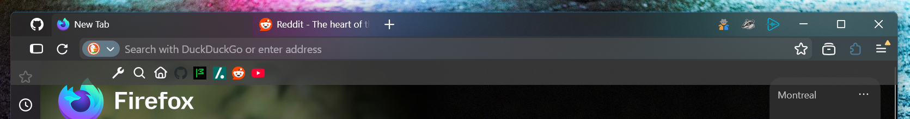

[Back to the README](../README.md) · [Settings](README.md)

# StockMica+: Firefox's own layout, with FoxMica's look
- **Two(three)-line layout**

StockMica+ is FoxOne-Mica with FoxOne's one-line bar switched off, so Firefox keeps its two rows. The palette, Mica, layers, URL dropdown and floating bookmarks bar are the same. It still needs Mica, so the [about:config prefs](../README.md#aboutconfig-prefs) apply.

To turn it on, open `userChrome.css`, comment out the `foxmica-config.css` import and uncomment the `micaplus-config.css` one. Use one, not both. Put `micaplus-config.css` in `chrome` next to the other files (six in all).

## Settings

`micaplus-config.css` loads `foxmica-config.css` first, so every setting there still applies. The `micaplus-config.css` file only holds the settings that differ. To change anything else, edit `foxmica-config.css` as usual.

| Setting | StockMica+ default | What it does |
| --- | --- | --- |
| `--ut-one-line` | `0` | `0` = Firefox's two rows. `1` = FoxOne's one-line bar. |
| `--uc-extensions-button-right` | `0` | The puzzle button isn't pinned to the corner. The run of extension icons touching it on its left is a drawer that opens when you hover the puzzle. `1` pins it like FoxOne-Mica. |
| `--ut-drawer-side` | `left` | Which side of the puzzle button the drawer picks icons up from and opens on: `left` or `right`. Only that side counts, so it never opens both ways. `left` keeps the puzzle under the pointer; `right` moves it. |
| `--uc-hide-extension-icons` | `1` | Only extension icons tuck away. Firefox's own buttons stay visible. |
| `--ut-drag-left`, `--uc-drag-space` | `16px`, `18px` | Window-drag areas left of the tabs and after them. |
| `--ut-findbar-left` | `1` | Floating find bar on the left. |
| `--ut-urlbar-padding` | `4px` | Space above and below the URL field (the tabs keep `--ut-bar-padding`, 2px). Remove the line for the same height as the other flavours. |
| `--ut-hide-disabled-nav` | `1` | Hide Forward while it has nowhere to go. |
| `--uc-autohide-nav-buttons` | `0` | Back, Forward and Reload always show. |
| `--uc-active-tab-width`, `--uc-inactive-tab-width`, `--uc-tab-min-width` | wider range | The tab row has more room than in the one-line bar. |
| `--ut-puzzle-color` | `AccentColor` | Puzzle button colour. |
| `--uc-show-all-tabs-button` | `1` | Show the all-tabs button. |
| `--ut-urlbar-fill`, `--ut-urlbar-fill-focus` | translucent white | Fill of the URL field, a little lighter than the bar. Not in the file by default; add them to change it. |

**PWAsForFirefox:** StockMica+ is tested in [PWAsForFirefox](https://github.com/filips123/PWAsForFirefox) windows. Their extension icons live in the title bar. Leave `--uc-extensions-button-right` at `0`: the drawer is whichever icons touch the puzzle button, in the title bar as in the nav bar. Icons dropped beside the puzzle land after it, so set `--ut-drawer-side: right` to pick them up.
